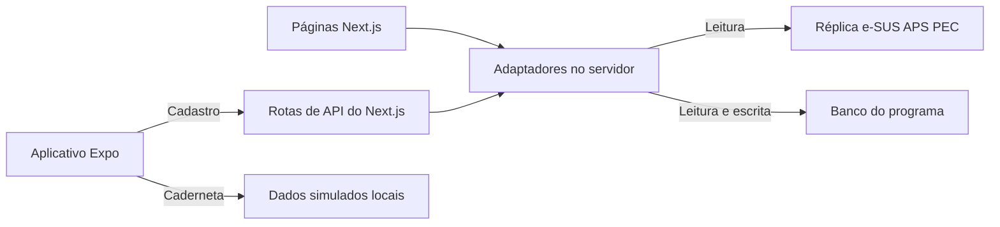

# Mãe Salvador MVP

[](package-lock.json) [](apps/dashboard/package.json) [](apps/mobile/package.json) [](apps/mobile/package.json) [](https://github.com/ayanliger/mae-salvador-mvp/blob/1630273a84a73b00028fb2c28392b00ebf532514/database/Dockerfile) [](https://github.com/facebook/react-native/blob/v0.81.5/packages/react-native/gradle/libs.versions.toml) [](https://github.com/facebook/react-native/blob/v0.81.5/packages/react-native/scripts/cocoapods/helpers.rb) [](LICENSE)

Registro do sprint inicial da caderneta digital do Programa Mãe Salvador, realizado de 12 a 17 de fevereiro de 2026. Reúne um dashboard para profissionais e gestores e um aplicativo da gestante, com experimentos de integração ao e-SUS APS PEC. O desenvolvimento posterior seguiu em repositórios privados; este código conserva o estado do sprint.

O dashboard demonstra a consulta de gestantes, a ficha clínica, o cadastro, os cartões de transporte e os indicadores, com perfis de profissional, cadastro e gestão. O aplicativo apresenta dados da gestação, consultas, exames, vacinas, medicações, orientações e o cartão do programa.

## Estado por branch

| Branch | Conteúdo |
|---|---|
| [master](https://github.com/ayanliger/mae-salvador-mvp/tree/master) | Interfaces com dados simulados; não contém rotas de API, pools de banco ou o diretório `database/` |
| [test4](https://github.com/ayanliger/mae-salvador-mvp/tree/test4) | Integração experimental do dashboard com PostgreSQL, 20 views, 19 rotas de API e cadastro mobile conectado; a caderneta mobile conserva dados simulados |
| `test`, `test2` e `test3` | Estados intermediários do sprint |

O dashboard utiliza Next.js 16, React 19.2, Shadcn/UI, Tailwind CSS v4, Recharts e TanStack Table. O aplicativo utiliza Expo SDK 54, React Native 0.81, React 19.1, Expo Router e Zustand. Os npm workspaces compartilham tipos, constantes e dados de demonstração em [packages/shared](packages/shared); na `test4`, o pacote também contém queries e mapeamentos do PEC.

## Integração na test4

Os links desta seção apontam para o snapshot de 17/02/2026 da `test4`. A decisão de domínio foi consultar os registros clínicos já existentes no PEC e manter os dados do programa em uma base própria, evitando uma segunda rotina de registro clínico.



| Base | Papel |
|---|---|
| Réplica do e-SUS APS | Dados clínicos e cadastrais, com acesso de leitura |
| Banco `mae_salvador` | Dados do programa, como cartões de transporte, etapas, consentimento, benefícios, atividades educativas e visitas à maternidade |

[db.ts](https://github.com/ayanliger/mae-salvador-mvp/blob/1630273a84a73b00028fb2c28392b00ebf532514/apps/dashboard/src/lib/db.ts) mantém dois pools com `pg`. A role `esus_leitura`, criada pelo [script de inicialização](https://github.com/ayanliger/mae-salvador-mvp/blob/1630273a84a73b00028fb2c28392b00ebf532514/database/init-db.sh), recebe permissões de leitura; o pool da réplica também configura `default_transaction_read_only`. O banco do programa utiliza um pool separado para suas operações de escrita.

A [migration 001](https://github.com/ayanliger/mae-salvador-mvp/blob/1630273a84a73b00028fb2c28392b00ebf532514/database/migrations/001_views.sql) define 20 views no schema `mae_salvador`. O acesso combina essas views com consultas diretas ao DW do PEC em [esus-queries.ts](https://github.com/ayanliger/mae-salvador-mvp/blob/1630273a84a73b00028fb2c28392b00ebf532514/packages/shared/src/esus-queries.ts) e [esus-data.ts](https://github.com/ayanliger/mae-salvador-mvp/blob/1630273a84a73b00028fb2c28392b00ebf532514/apps/dashboard/src/lib/esus-data.ts). O DW fornece a maior parte dos registros clínicos; as views também traduzem dados transacionais de organização e evoluções SOAP, com seleção de versões vigentes por `DISTINCT ON` e campos de auditoria. O SQL permanece explícito, sem ORM, para manter as consultas e o mapeamento desse schema no código.

[data.ts](https://github.com/ayanliger/mae-salvador-mvp/blob/1630273a84a73b00028fb2c28392b00ebf532514/apps/dashboard/src/lib/data.ts), [esus-data.ts](https://github.com/ayanliger/mae-salvador-mvp/blob/1630273a84a73b00028fb2c28392b00ebf532514/apps/dashboard/src/lib/esus-data.ts) e [app-data.ts](https://github.com/ayanliger/mae-salvador-mvp/blob/1630273a84a73b00028fb2c28392b00ebf532514/apps/dashboard/src/lib/app-data.ts) separam os dados simulados, a leitura clínica e a persistência do programa. A substituição ocorre por função; algumas rotas ainda usam dados simulados. `MockBadge` e `MockSection`, em [mock-badge.tsx](https://github.com/ayanliger/mae-salvador-mvp/blob/1630273a84a73b00028fb2c28392b00ebf532514/apps/dashboard/src/components/mock-badge.tsx), identificam trechos simulados na interface.

A classificação de risco em `esus-data.ts` deriva dos códigos CID-10 e CIAP-2 registrados no prontuário. A regra do sprint cobre condições obstétricas, infecções e doenças crônicas; os comentários indicam como referências o Manual de Gestação de Alto Risco (2022) e o Caderno de Atenção Básica nº 32. Esse mapeamento é parte do experimento de integração.

O Next.js expõe [19 rotas de API](https://github.com/ayanliger/mae-salvador-mvp/tree/1630273a84a73b00028fb2c28392b00ebf532514/apps/dashboard/src/app/api), enquanto as páginas do dashboard também carregam os dados diretamente pelos adaptadores no servidor. No mobile, o [cadastro](https://github.com/ayanliger/mae-salvador-mvp/blob/1630273a84a73b00028fb2c28392b00ebf532514/apps/mobile/app/cadastro.tsx) chama `/api/cadastro` pelo endereço definido em [Api.ts](https://github.com/ayanliger/mae-salvador-mvp/blob/1630273a84a73b00028fb2c28392b00ebf532514/apps/mobile/constants/Api.ts); as telas da caderneta ainda usam dados simulados locais. A rota [/api/health](https://github.com/ayanliger/mae-salvador-mvp/blob/1630273a84a73b00028fb2c28392b00ebf532514/apps/dashboard/src/app/api/health/route.ts) informa o estado das duas conexões, mas seu status HTTP depende apenas da conexão e-SUS; é necessário conferir também o campo `app` da resposta.

## Executar a demonstração da master

Requisitos: Node.js 20.19.4 ou superior e npm. Os dois aplicativos usam dados simulados nesta branch e dispensam os bancos da integração.

```sh
npm ci
npm run dev --workspace=apps/dashboard
```

Em outro terminal, para o aplicativo em modo web:

```sh
npm run web --workspace=apps/mobile
```

O pacote compartilhado contém os dados da demonstração. As referências de domínio do sprint estão em [Caderneta da Gestante, 8ª edição](docs/caderneta_gestante_8ed.pdf) e [requisitos do projeto](docs/requirementos_projeto_v2.pdf).

## Executar a integração da test4

Em um checkout da `test4`, são necessários Docker e uma cópia local autorizada do PEC, que não acompanha o repositório. O [Compose](https://github.com/ayanliger/mae-salvador-mvp/blob/1630273a84a73b00028fb2c28392b00ebf532514/docker-compose.yml) monta `database/` em `/dump`; antes de executar, confira o nome de arquivo esperado pelo [init-db.sh](https://github.com/ayanliger/mae-salvador-mvp/blob/1630273a84a73b00028fb2c28392b00ebf532514/database/init-db.sh) e ajuste-o à cópia disponível. O script restaura o dump, cria a role de leitura e o banco do programa e aplica as migrations.

```sh
npm ci
docker compose up -d
```

Defina `ESUS_DATABASE_URL` e `APP_DATABASE_URL` no ambiente do dashboard e execute os comandos dos aplicativos descritos acima. Confira os campos da resposta de `/api/health` e utilize [validation_queries.sql](https://github.com/ayanliger/mae-salvador-mvp/blob/1630273a84a73b00028fb2c28392b00ebf532514/database/validation_queries.sql) para comparar as views com os registros da cópia do PEC. O script de restauração permite continuar após uma falha de `pg_restore`, portanto a subida do container não confirma que os dados foram restaurados.

## Limites do sprint

- A autenticação é simulada. A seleção de perfil e os níveis de acesso da interface não implementam autorização de servidor, e não há auditoria de acesso.
- A leitura do DW depende do dump e do ETL utilizado; não representa atualização em tempo real. O mapeamento do PEC está associado ao schema estudado no sprint e exige revisão para outra versão.
- Não há escrita de volta ao e-SUS. FHIR, RNDS, LEDI e autenticação gov.br aparecem como possibilidades de evolução no [README histórico da test4](https://github.com/ayanliger/mae-salvador-mvp/blob/1630273a84a73b00028fb2c28392b00ebf532514/README.md), sem implementação correspondente neste snapshot.
- Existe um teste de componente herdado do template Expo, sem comando de execução configurado. Não há suíte de testes de domínio nem pipeline de CI.
- A integração foi preparada para estudo local. O sprint não define uma implantação de produção para os bancos e os registros identificados.

## Licença

[MIT](LICENSE).
