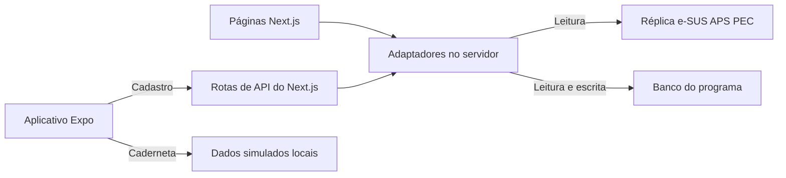

# Mãe Salvador MVP

[](package-lock.json) [](apps/dashboard/package.json) [](apps/mobile/package.json) [](apps/mobile/package.json) [](https://github.com/ayanliger/mae-salvador-mvp/blob/1630273a84a73b00028fb2c28392b00ebf532514/database/Dockerfile) [](https://github.com/facebook/react-native/blob/v0.81.5/packages/react-native/gradle/libs.versions.toml) [](https://github.com/facebook/react-native/blob/v0.81.5/packages/react-native/scripts/cocoapods/helpers.rb) [](LICENSE)

Registro do sprint inicial da caderneta digital do Programa Mãe Salvador (12 a 17 de fevereiro de 2026), com dashboard para profissionais e gestores e aplicativo da gestante. O desenvolvimento posterior seguiu em repositórios privados; este código conserva a demonstração simulada na `master` e os experimentos de integração ao e-SUS APS PEC na `test4`.

## Executar localmente

A branch `master` executa os dois aplicativos com dados simulados e dispensa banco de dados; a `test4` adiciona a integração experimental com PostgreSQL.

### Demonstração na master

Requisitos: Node.js 20.19.4 ou superior e npm.

```sh
npm ci
npm run dev --workspace=apps/dashboard
```

Em outro terminal, para o aplicativo em modo web:

```sh
npm run web --workspace=apps/mobile
```

### Integração local na test4

Em um checkout da `test4`, são necessários Docker e uma cópia local autorizada do PEC, não incluída no repositório.

1. Confira o nome de arquivo esperado pelo [init-db.sh](https://github.com/ayanliger/mae-salvador-mvp/blob/1630273a84a73b00028fb2c28392b00ebf532514/database/init-db.sh) e ajuste-o à cópia disponível em `database/`, montada em `/dump` pelo [Compose](https://github.com/ayanliger/mae-salvador-mvp/blob/1630273a84a73b00028fb2c28392b00ebf532514/docker-compose.yml).
2. Instale as dependências e suba os bancos (o script restaura o dump, cria a role de leitura, cria o banco do programa e aplica as migrations):
   ```sh
   npm ci
   docker compose up -d
   ```
3. Defina `ESUS_DATABASE_URL` e `APP_DATABASE_URL` no ambiente do dashboard e execute os aplicativos pelos comandos acima.
4. Confira `/api/health` e utilize [validation_queries.sql](https://github.com/ayanliger/mae-salvador-mvp/blob/1630273a84a73b00028fb2c28392b00ebf532514/database/validation_queries.sql) para comparar as views com os registros da cópia do PEC.

## Estrutura e branches

O monorepo usa npm workspaces e reúne dois aplicativos, um pacote compartilhado e as referências de domínio do sprint:

| Local | Papel |
|---|---|
| [apps/dashboard](apps/dashboard/README.md) | Painel Next.js 16 (React 19.2, Shadcn/UI, Tailwind CSS v4, Recharts, TanStack Table) com consulta de gestantes, ficha clínica, cadastro, cartões de transporte, indicadores e perfis simulados |
| `apps/mobile` | Aplicativo Expo SDK 54 (React Native 0.81, React 19.1, Expo Router, Zustand) com dados da gestação, consultas, exames, vacinas, medicações, orientações e cartão do programa |
| [packages/shared](packages/shared) | Tipos, constantes e dados simulados; na `test4`, inclui queries e mapeamentos do PEC |
| `docs/` | Referências de domínio: [Caderneta da Gestante, 8ª edição](docs/caderneta_gestante_8ed.pdf) e [requisitos do projeto](docs/requirementos_projeto_v2.pdf) |

O código do sprint distribui-se pelas branches abaixo:

| Branch | Conteúdo |
|---|---|
| [master](https://github.com/ayanliger/mae-salvador-mvp/tree/master) | Interfaces com dados simulados; sem rotas de API, pools de banco ou diretório `database/` |
| [test4](https://github.com/ayanliger/mae-salvador-mvp/tree/test4) | Integração experimental do dashboard com PostgreSQL, 20 views, 19 rotas de API e cadastro mobile conectado; a caderneta mobile conserva dados simulados |
| `test`, `test2` e `test3` | Estados intermediários do sprint |

## Arquitetura na test4

Os links desta seção apontam para o snapshot de 17/02/2026 da `test4`. A decisão de domínio foi consultar os registros clínicos já existentes no PEC e manter os dados do programa em base própria, evitando uma segunda rotina de registro clínico.



As duas bases separam leitura clínica e escrita do programa:

| Base | Papel |
|---|---|
| Réplica do e-SUS APS | Dados clínicos e cadastrais, com acesso de leitura |
| Banco `mae_salvador` | Dados do programa, como cartões de transporte, etapas, consentimento, benefícios, atividades educativas e visitas à maternidade |

Principais mecanismos da arquitetura no snapshot da `test4`:

- [db.ts](https://github.com/ayanliger/mae-salvador-mvp/blob/1630273a84a73b00028fb2c28392b00ebf532514/apps/dashboard/src/lib/db.ts): mantém dois pools `pg`; o pool da réplica usa a role `esus_leitura` (criada pelo [init-db.sh](https://github.com/ayanliger/mae-salvador-mvp/blob/1630273a84a73b00028fb2c28392b00ebf532514/database/init-db.sh)) e define `default_transaction_read_only`.
- [001_views.sql](https://github.com/ayanliger/mae-salvador-mvp/blob/1630273a84a73b00028fb2c28392b00ebf532514/database/migrations/001_views.sql), [esus-queries.ts](https://github.com/ayanliger/mae-salvador-mvp/blob/1630273a84a73b00028fb2c28392b00ebf532514/packages/shared/src/esus-queries.ts) e [esus-data.ts](https://github.com/ayanliger/mae-salvador-mvp/blob/1630273a84a73b00028fb2c28392b00ebf532514/apps/dashboard/src/lib/esus-data.ts): definem 20 views no schema `mae_salvador` e executam SQL explícito (sem ORM) sobre o DW do PEC e tabelas transacionais com `DISTINCT ON`.
- [data.ts](https://github.com/ayanliger/mae-salvador-mvp/blob/1630273a84a73b00028fb2c28392b00ebf532514/apps/dashboard/src/lib/data.ts), [esus-data.ts](https://github.com/ayanliger/mae-salvador-mvp/blob/1630273a84a73b00028fb2c28392b00ebf532514/apps/dashboard/src/lib/esus-data.ts) e [app-data.ts](https://github.com/ayanliger/mae-salvador-mvp/blob/1630273a84a73b00028fb2c28392b00ebf532514/apps/dashboard/src/lib/app-data.ts): separam dados simulados, leitura clínica e persistência do programa; `MockBadge` e `MockSection` ([mock-badge.tsx](https://github.com/ayanliger/mae-salvador-mvp/blob/1630273a84a73b00028fb2c28392b00ebf532514/apps/dashboard/src/components/mock-badge.tsx)) sinalizam trechos ainda simulados.
- Classificação de risco: deriva em `esus-data.ts` dos códigos CID-10 e CIAP-2 registrados no prontuário, com referências ao Manual de Gestação de Alto Risco (2022) e ao Caderno de Atenção Básica nº 32 nos comentários.
- [apps/dashboard/src/app/api](https://github.com/ayanliger/mae-salvador-mvp/tree/1630273a84a73b00028fb2c28392b00ebf532514/apps/dashboard/src/app/api) e cliente mobile: o Next.js expõe 19 rotas; no mobile, [cadastro.tsx](https://github.com/ayanliger/mae-salvador-mvp/blob/1630273a84a73b00028fb2c28392b00ebf532514/apps/mobile/app/cadastro.tsx) envia para `/api/cadastro` via [Api.ts](https://github.com/ayanliger/mae-salvador-mvp/blob/1630273a84a73b00028fb2c28392b00ebf532514/apps/mobile/constants/Api.ts), enquanto a caderneta lê dados simulados locais.

## Limites do sprint

- Autenticação simulada: a seleção de perfil e os níveis de acesso da interface não aplicam autorização no servidor, e não há auditoria de acesso.
- Leitura e restauração do DW: os dados dependem do dump e do ETL utilizado (sem atualização em tempo real), o mapeamento do PEC está acoplado ao schema estudado no sprint, e o `init-db.sh` tolera falha de `pg_restore` com `|| true`.
- Checagem de saúde parcial: [/api/health](https://github.com/ayanliger/mae-salvador-mvp/blob/1630273a84a73b00028fb2c28392b00ebf532514/apps/dashboard/src/app/api/health/route.ts) reporta `esus` e `app` no JSON, mas o status HTTP considera apenas `esus`.
- Sem escrita no e-SUS: FHIR, RNDS, LEDI e autenticação gov.br aparecem apenas como possibilidades futuras no [README histórico da test4](https://github.com/ayanliger/mae-salvador-mvp/blob/1630273a84a73b00028fb2c28392b00ebf532514/README.md).
- Verificação restrita a `@mae-salvador/shared`: `npm run shared:build` compila o pacote compartilhado; há apenas um teste de componente herdado do template Expo sem comando configurado, o `lint` do dashboard possui erro pré-existente em `src/components/ui/sidebar.tsx` e não há pipeline de CI.
- Escopo local da integração: a configuração da `test4` atende ao estudo local e não define implantação de produção para bancos e registros identificados.

## Licença

[MIT](LICENSE).
